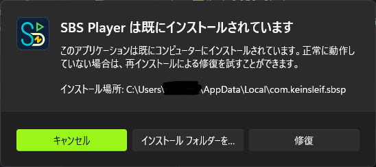

# v2からv3への移行

## Windows

### 1. 既存のSBS Playerのアンインストール

この操作を行わなくてもv3をインストール可能ですが、v2のアプリ本体などが残る可能性があるため、アンインストールを推奨します。

- 「設定」アプリ→「アプリ」項目→「インストールされているアプリ」を開きます。
- アプリの一覧から「SBS Player」を探し、「⋯」メニューからアンインストールを選択します。
- 表示されたアンインストーラーの案内に従ってアンインストールを行います。

### 2. SBS Player v3 のインストール

- [インストール方法](../installation) から、最新版のインストーラーをダウンロードします。

- アンインストールを行わなかった場合、以下のようなダイアログが表示されるので「修復」をクリックします。

- 自動でインストールが進み、インストールされた最新バージョンが開かれます。

## macOS

dmgにてアプリケーションフォルダにインストールしている場合、pkgによるインストールやPortableインストールにより新しいバージョンに自動的に上書きされます。

## Linux

AppImageをダウンロードし、既存のAppImageを上書きしてください。
